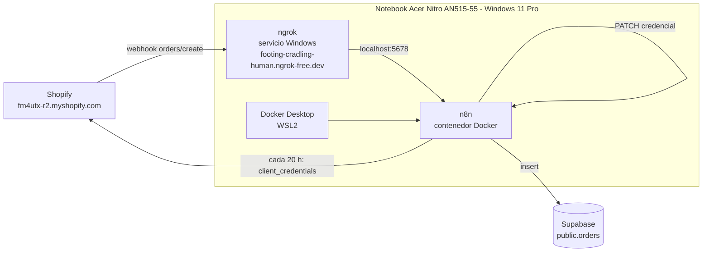

# PROJECT_STATUS — DROPP

## INSTRUCCIONES PARA AGENTES DE IA

1. **Al iniciar cada sesión:** leer este archivo completo antes de ejecutar cualquier acción.
2. **Al finalizar cada sesión:** actualizar las secciones afectadas y añadir una entrada nueva en la *Bitácora de sesiones*.
3. **Nunca borrar historial.** Las entradas antiguas de la bitácora no se editan ni se eliminan; las correcciones se registran como entradas nuevas.
4. **Nunca escribir secretos aquí** (tokens, API keys, client secrets, contraseñas, authtokens). Solo nombres e IDs de credenciales.
5. **No marcar nada como completado sin verificarlo** con una prueba real; indicar cómo se verificó.
6. No modificar ni eliminar workflows, credenciales o integraciones funcionales sin autorización y sin copia de seguridad.
7. Si una tarea requiere permisos de administrador, detenerse, preparar los comandos y pedir autorización. No eludir permisos.
8. No reiniciar Windows ni cerrar procesos críticos sin autorización.
9. No desactivar Windows Defender, actualizaciones de seguridad ni otros mecanismos de seguridad.

---

## 1. Objetivo del proyecto

DROPP es un negocio de dropshipping internacional sobre Shopify, automatizado con n8n. El objetivo es que pedidos, inventario, proveedores (AutoDS), base de datos (Supabase), reportes y notificaciones (Telegram) funcionen de forma autónoma, supervisados por un orquestador multiagente.

Estado actual: **fase de infraestructura e integración base** — el flujo Shopify → n8n → Supabase para pedidos nuevos funciona de extremo a extremo.

## 2. Arquitectura

| Componente | Detalle | Arranque |
|---|---|---|
| Equipo | Acer Nitro AN515-55, i5-10300H, ~16 GB RAM, Windows 11 Pro 10.0.26300 | — |
| ngrok | v3.39.13, ejecutable en ruta de winget (`%LOCALAPPDATA%\Microsoft\WinGet\Packages\Ngrok.Ngrok_...\ngrok.exe`). Config `%LOCALAPPDATA%\ngrok\ngrok.yml`, túnel `n8n` → `localhost:5678`, dominio estático `footing-cradling-human.ngrok-free.dev`. Log: `%LOCALAPPDATA%\ngrok\ngrok-service.log` | Servicio Windows `ngrok`, cuenta LocalSystem, inicio automático retrasado, recuperación: reinicio a 5 s / 15 s / 60 s (reset 24 h). **Arranca sin inicio de sesión.** |
| Docker Desktop | Backend WSL2 (distro `docker-desktop`). Sin `com.docker.service` | Clave `HKCU\...\Run` → **solo tras iniciar sesión de usuario** |
| n8n | Imagen `n8nio/n8n`, contenedor `n8n`, volumen `n8n_data:/home/node/.n8n`, puerto `0.0.0.0:5678`, `WEBHOOK_URL=https://footing-cradling-human.ngrok-free.dev/` | `restart=unless-stopped` (depende de Docker Desktop) |
| Supabase | Tabla `public.orders`, RLS activo, `service_role` con SELECT/INSERT/UPDATE/DELETE | Cloud |
| Shopify | Tienda `fm4utx-r2`, moneda ARS. App Dev Dashboard **N8N-INTEGRATION** (grant `client_credentials`, token 24 h). Webhook id `2110917378284`, API `2026-10` | Cloud |

**Energía (plan Equilibrado `381b4222-f694-41f0-9685-ff5bb260df2e`):**

| Ajuste | Enchufado (AC) | Batería (DC) |
|---|---|---|
| Cerrar tapa | No hacer nada | Suspender |
| Suspender tras | Nunca | 15 min |
| Hibernar tras | Nunca | 60 min |
| Apagar pantalla tras | 10 min | 5 min |

## 3. Credenciales (solo nombres e IDs — nunca valores)

| ID n8n | Nombre | Uso |
|---|---|---|
| `VEFwfxVaUk4jqARk` | Shopify Access Token API | Shopify Trigger y API. El `accessToken` se rota automáticamente cada 20 h |
| `OkSSpZySsG00UK0E` | Shopify App Client Credentials | Custom auth para pedir el token (client_credentials), dominio permitido `fm4utx-r2.myshopify.com` |
| `mgqDeGBdKxiQ5rXT` | n8n API (renovar token Shopify) | API pública de n8n (`http://localhost:5678/api/v1`) para actualizar la credencial anterior |
| `4OmNCiAwiUfzgR8m` | Supabase | Insert en `orders` |
| `nHLUcrDMAuqcb3r6` | Gemini | Borradores de agentes IA |
| `dzAaaZNv4JxuQNpM` | SearchApi | Borradores de agentes IA |

Otros secretos fuera de n8n: authtoken de ngrok (en `ngrok.yml`, perfil del usuario). Copias de seguridad con secretos en `C:\Users\ceehv\Desktop\MI AGENTE\backups\` (fuera del repo, ACL restringida). **No copiar al repositorio.**

## 4. Workflows de n8n

| ID | Nombre | Estado | Función |
|---|---|---|---|
| `PR54fGQkhKgwaWZU` | Shopify Webhook - Pedidos | **Activo** | Shopify Trigger `orders/create` → Supabase create en `orders` (`shopify_order_id`, `order_number`, `total_usd`, `currency`, `customer_email`, `financial_status`, `ordered_at`). Verificado con pedido firmado real |
| `SqtTp6pHFD1uyopA` | Shopify - Renovar Access Token | **Activo** | Schedule cada 20 h → POST token Shopify → PATCH `/api/v1/credentials/VEFwfxVaUk4jqARk` (`isPartialData`). Reintentos ×3. Verificado con ejecución real |
| `Ha6u0tTOifNmQBNh` | Reporte diario de pedidos Supabase (plantilla 4406) | Inactivo (borrador) | Agente Gemini + herramientas Supabase + Gmail |
| `KtE0RxKUEXAcpK1f` | Shopify MCP Server + Asistente (plantilla 12296) | Inactivo (borrador) | 8 errores de validación (p. ej. `MISSING_MCP_ENDPOINT`) |
| `IdFQYxr9nxv56ACM` | My workflow | Inactivo | Chat trigger + agente Gemini |

## 5. Infraestructura verificada

| Verificación | Resultado | Fecha |
|---|---|---|
| Servicio `ngrok` | `Running`, `StartMode=Auto`, `DelayedAutoStart=True`, `LocalSystem`, 1 proceso | 2026-11-21 |
| Reinicio del servicio (prueba de recuperación) | Túnel vuelve, `/healthz` HTTP 200 | 2026-11-21 |
| Túnel `n8n` | `https://footing-cradling-human.ngrok-free.dev` → `http://localhost:5678`, `/healthz` 200 | 2026-11-21 |
| Tapa cerrada + enchufado | Prueba física correcta (informada por el usuario) | 2026-11-21 |
| Copia del plan de energía | `backups\powerplan_equilibrado_post_20261121.pow` (8192 B, estado ya modificado) | 2026-11-21 |
| n8n | Contenedor `Up`, `restart=unless-stopped` | 2026-11-21 |

## 6. Riesgos y problemas conocidos

1. **n8n depende del inicio de sesión.** Docker Desktop arranca desde `HKCU\Run`; tras un reinicio (p. ej. Windows Update) n8n queda caído hasta que el usuario inicia sesión, aunque ngrok sí arranque. Alternativa futura: VPS.
2. **En batería, cerrar la tapa suspende** el equipo y corta el servicio.
3. **Sobrecalentamiento** con la tapa cerrada (Nitro AN515-55). Usar superficie dura y vigilar temperaturas.
4. **Valor previo de LIDACTION desconocido** (se cambió antes de leerlo). El `.pow` guardado refleja el estado *posterior*; los valores previos del resto están en `backups\powerplan_valores_previos_20261121.txt`.
5. **Secretos expuestos en el chat** de sesiones anteriores: authtoken ngrok, client secrets de las dos apps de Shopify, API key de n8n. **Pendiente rotarlos.**
6. **Puerto 5678 publicado en `0.0.0.0`** (toda la red local).
7. **`total_usd` guarda importes en ARS** (la tienda usa ARS). Falta conversión o renombrar columna.
8. **Insert sin upsert:** reintentos de Shopify pueden chocar con `shopify_order_id` único (fallo en vez de duplicado).
9. **El servicio usa el exe de la ruta de winget**; un `winget upgrade` que cambie la ruta rompería el servicio.
10. **`ngrok-service.log` sin rotación.**
11. **`settings-store.json` de Docker dice `AutoStart=False`** pero existe la clave Run; no verificado cuál prevalece.
12. **El repo no tiene `.gitignore`.**

## 7. Pendientes / próximos pasos

- [ ] Rotar secretos expuestos (ngrok, Shopify ×2, n8n API key) y actualizar credenciales n8n.
- [ ] Decidir sobre la dependencia de sesión (aceptar, auto-login, o migrar n8n a VPS).
- [ ] Upsert en el workflow de pedidos y corregir moneda / `total_usd`.
- [ ] Añadir `.gitignore` (backups, `.env`, `*.bak`, `*.pow`).
- [ ] Limitar el puerto de n8n a `127.0.0.1:5678` (requiere recrear el contenedor; planificar con copia del volumen).
- [ ] Siguientes fases de la *GUIA DROPP*: AutoDS, Telegram, reporte diario, orquestador.

## 8. Bitácora de sesiones

### 2026-11-20
- Instalado ngrok (winget 3.3.1 → `ngrok update` 3.39.13); túnel a 5678 con dominio estático.
- n8n en Docker con `WEBHOOK_URL` y volumen `n8n_data`.
- Creada app Shopify N8N-INTEGRATION (client_credentials) y credencial `VEFwfxVaUk4jqARk`.
- Workflow `PR54fGQkhKgwaWZU` (orders/create → Supabase). Primeras ejecuciones con 403 de Supabase; resuelto con GRANT a `service_role` hecho por el usuario. Prueba firmada correcta; fila de prueba eliminada.
- Workflow `SqtTp6pHFD1uyopA` de renovación de token cada 20 h, ejecutado y verificado.

### 2026-11-21
- Ajustes de energía aplicados (tabla en §2). `powercfg /export` falló sin admin (0x522); valores previos anotados en `backups\powerplan_valores_previos_20261121.txt`.
- `ngrok.yml` ampliado con túnel `n8n` y log (copia previa en `backups\ngrok.yml.20261121_121634.bak`).
- n8n `restart` cambiado de `no` a `unless-stopped`.
- Creado `scripts/install-ngrok-service.ps1`. Ejecutado por el usuario como administrador: detuvo el ngrok manual (PID 24456), instaló el servicio, prueba de reinicio OK (log `%LOCALAPPDATA%\ngrok\install-service.log`).
- Usuario exportó el plan de energía como admin (`powerplan_equilibrado_post_20261121.pow`) y verificó físicamente tapa cerrada + enchufado.
- Auditoría de solo lectura: servicio, túnel, backups y contenedor verificados.
- Carpeta `Scrips` renombrada a `scripts`. Creado este `PROJECT_STATUS.md`.
