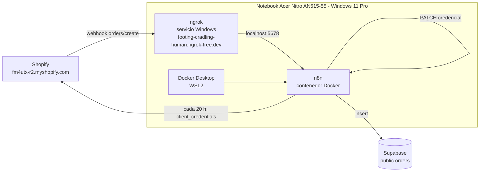

# PROJECT_STATUS — DROPP

## INSTRUCCIONES PARA AGENTES DE IA

1. **Al iniciar cada sesión:** leer este archivo completo antes de ejecutar cualquier acción.
2. **Al finalizar cada sesión:** actualizar las secciones afectadas y añadir una entrada nueva en la *Bitácora de sesiones*.
3. **Nunca borrar historial.** Las entradas antiguas de la bitácora no se editan ni se eliminan; las correcciones se registran como entradas nuevas.
4. **Nunca escribir secretos aquí** (tokens, API keys, client secrets, contraseñas, authtokens). Solo nombres e IDs de credenciales.
5. **No marcar nada como completado sin verificarlo** con una prueba real; indicar cómo se verificó.
6. No modificar ni eliminar workflows, credenciales o integraciones funcionales sin autorización y sin copia de seguridad.
7. Si una tarea requiere permisos de administrador, detenerse, preparar los comandos y pedir autorización. No eludir permisos.
8. No reiniciar Windows ni cerrar procesos críticos sin autorización.
9. No desactivar Windows Defender, actualizaciones de seguridad ni otros mecanismos de seguridad.
10. **Sincronización git obligatoria.** Después de cualquier cambio técnico relevante en este archivo, ejecutar `git add PROJECT_STATUS.md && git commit -m "<descripción>" && git push`. El GitHub repo (https://github.com/igadgetslove10/n8n-auto-dropp.git) es la fuente que cualquier AI debe poder leer.
11. **No confiar en memoria de sesiones anteriores.** Cualquier AI (Claude, Z Code, Gemini, ChatGPT, etc.) que arranque una sesión nueva DEBE leer este archivo completo antes de responder. La bitácora (§8) es el historial confiable; la memoria del modelo NO lo es.
12. **AGENTS.md como referencia rápida.** Para el stack actual, reglas de operación y workflows activos sin tener que leer PROJECT_STATUS.md completo, ver `AGENTS.md` en la raíz del repo.

---

## 1. Objetivo del proyecto

DROPP es un negocio de dropshipping internacional sobre Shopify, automatizado con n8n. El objetivo es que pedidos, inventario, proveedores (AutoDS), base de datos (Supabase), reportes y notificaciones (Telegram) funcionen de forma autónoma, supervisados por un orquestador multiagente.

Estado actual: **fase de infraestructura e integración base** — el flujo Shopify → n8n → Supabase para pedidos nuevos funciona de extremo a extremo.

## 2. Arquitectura

| Componente | Detalle | Arranque |
|---|---|---|
| Equipo | Acer Nitro AN515-55, i5-10300H, ~16 GB RAM, Windows 11 Pro 10.0.26300 | — |
| ngrok | v3.39.13, ejecutable en ruta de winget (`%LOCALAPPDATA%\Microsoft\WinGet\Packages\Ngrok.Ngrok_...\ngrok.exe`). Config `%LOCALAPPDATA%\ngrok\ngrok.yml`, túnel `n8n` → `localhost:5678`, dominio estático `footing-cradling-human.ngrok-free.dev`. Log: `%LOCALAPPDATA%\ngrok\ngrok-service.log` | Servicio Windows `ngrok`, cuenta LocalSystem, inicio automático retrasado, recuperación: reinicio a 5 s / 15 s / 60 s (reset 24 h). **Arranca sin inicio de sesión.** |
| Docker Desktop | Backend WSL2 (distro `docker-desktop`). Sin `com.docker.service` | Clave `HKCU\...\Run` → **solo tras iniciar sesión de usuario** |
| n8n | Imagen `n8nio/n8n`, contenedor `n8n`, volumen `n8n_data:/home/node/.n8n`, puerto `0.0.0.0:5678`, `WEBHOOK_URL=https://footing-cradling-human.ngrok-free.dev/` | `restart=unless-stopped` (depende de Docker Desktop) |
| Supabase | Tabla `public.orders`, RLS activo, `service_role` con SELECT/INSERT/UPDATE/DELETE | Cloud |
| Shopify | Tienda `fm4utx-r2`, moneda ARS. App Dev Dashboard **N8N-INTEGRATION** (grant `client_credentials`, token 24 h). Webhook id `2110917378284`, API `2026-10` | Cloud |

**Energía (plan Equilibrado `381b4222-f694-41f0-9685-ff5bb260df2e`):**

| Ajuste | Enchufado (AC) | Batería (DC) |
|---|---|---|
| Cerrar tapa | No hacer nada | Suspender |
| Suspender tras | Nunca | 15 min |
| Hibernar tras | Nunca | 60 min |
| Apagar pantalla tras | 10 min | 5 min |

## 3. Credenciales (solo nombres e IDs — nunca valores)

| ID n8n | Nombre | Uso |
|---|---|---|
| `VEFwfxVaUk4jqARk` | Shopify Access Token API | Shopify Trigger y API. El `accessToken` se rota automáticamente cada 20 h |
| `OkSSpZySsG00UK0E` | Shopify App Client Credentials | Custom auth para pedir el token (client_credentials), dominio permitido `fm4utx-r2.myshopify.com` |
| `mgqDeGBdKxiQ5rXT` | n8n API (renovar token Shopify) | API pública de n8n (`http://localhost:5678/api/v1`) para actualizar la credencial anterior |
| `4OmNCiAwiUfzgR8m` | Supabase | Insert en `orders` |
| `nHLUcrDMAuqcb3r6` | Gemini | Borradores de agentes IA |
| `dzAaaZNv4JxuQNpM` | SearchApi | Borradores de agentes IA |

Otros secretos fuera de n8n: authtoken de ngrok (en `ngrok.yml`, perfil del usuario). Copias de seguridad con secretos en `C:\Users\ceehv\Desktop\MI AGENTE\backups\` (fuera del repo, ACL restringida). **No copiar al repositorio.**

## 4. Workflows de n8n

| ID | Nombre | Estado | Función |
|---|---|---|---|
| `PR54fGQkhKgwaWZU` | Shopify Webhook - Pedidos | **Activo** | Shopify Trigger `orders/create` → Supabase create en `orders` (`shopify_order_id`, `order_number`, `total_usd`, `currency`, `customer_email`, `financial_status`, `ordered_at`). Verificado con pedido firmado real |
| `SqtTp6pHFD1uyopA` | Shopify - Renovar Access Token | **Activo** | Schedule cada 20 h → POST token Shopify → PATCH `/api/v1/credentials/VEFwfxVaUk4jqARk` (`isPartialData`). Reintentos ×3. Verificado con ejecución real |
| `Ha6u0tTOifNmQBNh` | Reporte diario de pedidos Supabase (plantilla 4406) | Inactivo (borrador) | Agente Gemini + herramientas Supabase + Gmail |
| `KtE0RxKUEXAcpK1f` | Shopify MCP Server + Asistente (plantilla 12296) | Inactivo (borrador) | 8 errores de validación (p. ej. `MISSING_MCP_ENDPOINT`) |
| `IdFQYxr9nxv56ACM` | My workflow | Inactivo | Chat trigger + agente Gemini |
| `hNwyHv5LQAJ8GVNq` | Research - Productos Ganadores (US/USD) | Inactivo | Form Trigger + Gemini 2.5-flash + SearchApi (HTTP Request directo) + Supabase. Pipeline determinista: 3 llamadas SearchApi por producto, máx 15 por run. profit_analysis con gross_margin, profit_before_ads, profit_after_ads. Sin nodos Shopify. Modelo `gemini-3.5-flash` desde 2026-11-23 (2.5-flash retirado). Corte antes de SearchApi si no hay ideas válidas (`gemini_ideas_failed`). AliExpress vía engine `aliexpress_search` (páginas `/item/`). Análisis Gemini en bucle con reintentos (20 s) y fallback de modelo. `dry_run` + `ideas_override` para previsualizar queries. Run 3 (ejec. 32): 3 discarded `no_us_trend`; créditos = `run_stats` (9). `source_url` corregido después del run, pendiente de verificar en un run 4 |
| `B4sFMVncptK3CbgL` | TEMP - Verificaciones (modelos Gemini / creditos SearchApi) | Inactivo | Temporal: consulta `/api/v1/me` de SearchApi (créditos, gratis). No borrar sin autorización |

## 5. Infraestructura verificada

| Verificación | Resultado | Fecha |
|---|---|---|
| Servicio `ngrok` | `Running`, `StartMode=Auto`, `DelayedAutoStart=True`, `LocalSystem`, 1 proceso | 2026-11-21 |
| Reinicio del servicio (prueba de recuperación) | Túnel vuelve, `/healthz` HTTP 200 | 2026-11-21 |
| Túnel `n8n` | `https://footing-cradling-human.ngrok-free.dev` → `http://localhost:5678`, `/healthz` 200 | 2026-11-21 |
| Tapa cerrada + enchufado | Prueba física correcta (informada por el usuario) | 2026-11-21 |
| Copia del plan de energía | `backups\powerplan_equilibrado_post_20261121.pow` (8192 B, estado ya modificado) | 2026-11-21 |
| n8n | Contenedor `Up`, `restart=unless-stopped` | 2026-11-21 |

## 6. Riesgos y problemas conocidos

1. **n8n depende del inicio de sesión.** Docker Desktop arranca desde `HKCU\Run`; tras un reinicio (p. ej. Windows Update) n8n queda caído hasta que el usuario inicia sesión, aunque ngrok sí arranque. Alternativa futura: VPS.
2. **En batería, cerrar la tapa suspende** el equipo y corta el servicio.
3. **Sobrecalentamiento** con la tapa cerrada (Nitro AN515-55). Usar superficie dura y vigilar temperaturas.
4. **Valor previo de LIDACTION desconocido** (se cambió antes de leerlo). El `.pow` guardado refleja el estado *posterior*; los valores previos del resto están en `backups\powerplan_valores_previos_20261121.txt`.
5. **Secretos expuestos en el chat** de sesiones anteriores: authtoken ngrok, client secrets de las dos apps de Shopify, API key de n8n. **Pendiente rotarlos.**
6. **Puerto 5678 publicado en `0.0.0.0`** (toda la red local).
7. **`total_usd` guarda importes en ARS** (la tienda usa ARS). Falta conversión o renombrar columna.
8. **Insert sin upsert:** reintentos de Shopify pueden chocar con `shopify_order_id` único (fallo en vez de duplicado).
9. **El servicio usa el exe de la ruta de winget**; un `winget upgrade` que cambie la ruta rompería el servicio.
10. **`ngrok-service.log` sin rotación.**
11. **`settings-store.json` de Docker dice `AutoStart=False`** pero existe la clave Run; no verificado cuál prevalece.
12. **El repo no tiene `.gitignore`.**

## 7. Pendientes / próximos pasos

- [ ] Rotar secretos expuestos (ngrok, Shopify ×2, n8n API key) y actualizar credenciales n8n.
- [ ] Decidir sobre la dependencia de sesión (aceptar, auto-login, o migrar n8n a VPS).
- [ ] Upsert en el workflow de pedidos y corregir moneda / `total_usd`.
- [ ] Añadir `.gitignore` (backups, `.env`, `*.bak`, `*.pow`).
- [ ] Limitar el puerto de n8n a `127.0.0.1:5678` (requiere recrear el contenedor; planificar con copia del volumen).
- [x] Workflow `hNwyHv5LQAJ8GVNq`: cambiar modelo Gemini, cortar el flujo si no hay ideas, corregir el orden de `rejection_reason`, contar llamadas reales. Hecho el 2026-11-23 y verificado con la ejecución 28.
- [x] Workflow `hNwyHv5LQAJ8GVNq`: Trends "not enough data" → `no_us_trend`; contador real; bucle de reintento y fallback Gemini; engine `aliexpress_search` y `clean()` sin `URL`. Hecho el 2026-11-23 (run 3 / verificación offline).
- [ ] Run 4 (~9 créditos) para verificar `source_url` en una ejecución real (requiere autorización).
- [ ] Añadir una query de Trends corta (`trends_query`) separada de `search_query` (requiere autorización).
- [x] UPDATE de `source_url` en las 3 filas del run 3. Hecho el 2026-11-27 y verificado vía MCP.
- [ ] Decidir el borrado del workflow temporal `B4sFMVncptK3CbgL`.
- [ ] Siguientes fases de la *GUIA DROPP*: AutoDS, Telegram, reporte diario, orquestador.

## 8. Bitácora de sesiones

### 2026-11-20
- Instalado ngrok (winget 3.3.1 → `ngrok update` 3.39.13); túnel a 5678 con dominio estático.
- n8n en Docker con `WEBHOOK_URL` y volumen `n8n_data`.
- Creada app Shopify N8N-INTEGRATION (client_credentials) y credencial `VEFwfxVaUk4jqARk`.
- Workflow `PR54fGQkhKgwaWZU` (orders/create → Supabase). Primeras ejecuciones con 403 de Supabase; resuelto con GRANT a `service_role` hecho por el usuario. Prueba firmada correcta; fila de prueba eliminada.
- Workflow `SqtTp6pHFD1uyopA` de renovación de token cada 20 h, ejecutado y verificado.

### 2026-11-21
- Ajustes de energía aplicados (tabla en §2). `powercfg /export` falló sin admin (0x522); valores previos anotados en `backups\powerplan_valores_previos_20261121.txt`.
- `ngrok.yml` ampliado con túnel `n8n` y log (copia previa en `backups\ngrok.yml.20261121_121634.bak`).
- n8n `restart` cambiado de `no` a `unless-stopped`.
- Creado `scripts/install-ngrok-service.ps1`. Ejecutado por el usuario como administrador: detuvo el ngrok manual (PID 24456), instaló el servicio, prueba de reinicio OK (log `%LOCALAPPDATA%\ngrok\install-service.log`).
- Usuario exportó el plan de energía como admin (`powerplan_equilibrado_post_20261121.pow`) y verificó físicamente tapa cerrada + enchufado.
- Auditoría de solo lectura: servicio, túnel, backups y contenedor verificados.
- Carpeta `Scrips` renombrada a `scripts`. Creado este `PROJECT_STATUS.md`.

### 2026-11-23
- Recuperado contenedor n8n real (volumen n8n_data). n8n-old-novolume parado (no borrado).
- Workflow SqtTp6pHFD1uyopA (renovación token Shopify): añadido Manual Trigger para permitir ejecución CLI. Backup en C:\Users\ceehv\Desktop\MI AGENTE\backups\workflow_SqtTp6pHFD1uyopA_20261123_120603.json.
- Token Shopify renovado manualmente vía CLI (expires_in 86399, scopes write_inventory,write_orders,write_products). Conexión verificada con lectura real de producto 15613411393772.
- SQL ejecutado en Supabase: GRANT SELECT/INSERT/UPDATE en products y suppliers a service_role; índices únicos uq_products_source_url y uq_suppliers_name_platform creados. Este último sin lower() para soportar on_conflict upsert.
- Workflow hNwyHv5LQAJ8GVNq "Research - Productos Ganadores (US/USD)" construido, inactivo, validado (0 errores).
- Cambios de diseño vs spec original:
  - Pipeline determinista en vez de AI Agent (presupuesto SearchApi limitado).
  - HTTP Request directo a SearchApi en vez de community node (no exponía google_trends ni amazon engines).
  - AliExpress reemplaza Amazon como tercera búsqueda (necesita coste de proveedor real).
  - Índice suppliers sin lower() (on_conflict no soporta expresiones).
  - shipping_cost_usd = 0 válido (envío gratis en AliExpress común).
  - image_license siempre restricted/unknown (imágenes de Google Shopping no son comercialmente seguras).
  - Supplier frecuentemente "AliExpress (unverified seller)" con metadata.supplier_verified=false.
- Ejecución de prueba Etapa 4: nicho kitchen gadgets, 3 productos, 40% / USD 15.
- Resultados: **FALLIDA.** Ejecución n8n 23 (CLI, 24 s, status success). Ambos nodos Gemini devolvieron 404: `models/gemini-2.5-flash is no longer available to new users` (la API sugiere `gemini-3.8-flash`). Sin ideas, el run siguió con 1 item vacío: Shopping y Trends dieron 400 (`Missing required parameter q.`) y AliExpress dio 200 con `q="undefined ..."` (≈1 crédito gastado, quedan ≈99). Resultado: 0 candidate, 0 discarded, 1 incomplete. Verificado vía Supabase MCP: 0 filas en `products` y 0 en `suppliers`. Workflow NO modificado; el cambio de modelo queda pendiente de autorización. Detalle en `download/REPORTE_ETAPA4.md` y `download/BLOCKED_ACTIONS.log`.
- Fallos de manejo de errores detectados: el fallo de Gemini en las ideas no corta el flujo; el orden de `rejection_reason` da `search_failed` en vez de `parser_failed`; `run_stats.searchapi_calls` vale siempre 3.
- Nada publicado en Shopify. Nada creado en AutoDS.
- **Fixes autorizados aplicados a `hNwyHv5LQAJ8GVNq`** (backup `C:\Users\ceehv\Desktop\MI AGENTE\backups\workflow_hNwyHv5LQAJ8GVNq_20261123_145412.json`):
  - Modelo verificado con `GET /v1beta/models` y una prueba real de structured output. `gemini-3.8-flash` daba 503 "high demand" y `gemini-2.5-pro` daba 404, así que se eligió **`gemini-3.5-flash`**. Reintentos Gemini 3, espera 5 s.
  - Nuevo Code `Parsear y validar ideas` + IF `¿Hay ideas válidas?` (la rama false va a `Resumen` con `gemini_ideas_failed`).
  - Nuevo orden de `rejection_reason` (9 valores). Los fallos con título conocido se insertan como `discarded`.
  - `run_stats` con conteo real (`searchapi_calls`, `searchapi_success`, `gemini_calls`, `tokens_used`).
  - Validación: 0 errores, 0 avisos.
- Creado el workflow temporal `B4sFMVncptK3CbgL` (verificar modelos y créditos SearchApi). No borrado, por regla.
- **Run 2 (ejecución 28, 37 s):** 3 ideas, 3 filas insertadas, todas `discarded` (`search_failed` ×2 porque Trends devolvió "not enough data"; `parser_failed` ×1 por un 503 de Gemini tras 3 intentos). 0 candidate. Fórmulas de `profit_analysis` verificadas a mano: OK.
- Créditos SearchApi según el panel `/api/v1/me`: 96 antes → 84 después (12 consumidos). `run_stats` dice 11; las peticiones HTTP detectadas son 9. El run 1 consumió 4 (100 → 96).
- Ningún producto aprobable. Detalle en `download/REPORTE_ETAPA4.md`.
- **Fixes del run 3 autorizados** (backup `C:\Users\ceehv\Desktop\MI AGENTE\backups\workflow_hNwyHv5LQAJ8GVNq_20261123_160400.json`; aplicados con `n8n import:workflow` + MCP; validación 0 errores / 0 avisos):
  - Trends "not enough data" → `no_us_trend`.
  - `retryOnFail=false` explícito en los nodos SearchApi: los reintentos de n8n no actúan con `onError=continue`. Ahora el contador cuenta 1 por respuesta.
  - Bucle explícito de análisis Gemini (Loop Over Items + Wait 20 s; 3.5-flash ×3, luego 3.6 / 3.7 / 2.5-pro), porque `waitBetweenTries` está limitado a 5 s en n8n 2.46.6.
  - AliExpress pasa al engine `aliexpress_search`, solo enlaces `/item/`, y `source_url` debe ser uno de ellos.
  - Modo `dry_run` / `ideas_override`.
- Dry-run: 0 créditos. Queries revisadas (en el reporte). Run 3 con esas mismas ideas.
- **Run 3 (ejecución 32, 57 s):** 3 discarded, `no_us_trend` ×3 (Trends sin datos en las 3 queries de 4–5 palabras). Créditos 84 → 75 = 9 = `run_stats.searchapi_calls` ✅. Gemini 3/3 al primer intento. Fórmulas de `profit_analysis` OK en los 3.
- **Bug latente encontrado:** el sandbox de Code nodes no tiene `URL` (`URL is not defined`). `clean()` devolvía null siempre, así que `source_url` era null y la deduplicación no funcionaba desde la creación del workflow. Corregido con regex y verificado en el sandbox real y offline sobre el run 3 (3/3 URLs `/item/` válidas). **Run 4 no lanzado** (requiere autorización). Las filas del run 3 siguen con `source_url` null.
- `/api/v1/me` de SearchApi no consume créditos. Quedan **75**.
- `Parámetros de prueba` quedan en `dry_run=true`.

### 2026-11-27
- UPDATE de `source_url` ejecutado por el usuario en el SQL Editor (UPDATE 3) sobre las 3 filas del run 3 (ejecución 32), filtrando por `id`. URLs verificadas vía Supabase MCP (read-only):
  - Jar Opener (b9e6b0ad...) → aliexpress.us/item/3256807619118033.html
  - Glass Rinser (a5fc0da8...) → aliexpress.us/item/3256806811035402.html
  - Salad Spinner (8e44f84a...) → aliexpress.us/item/3256804517692811.html
- `metadata.source_url_fixed = true` en las 3. El fix de `clean()` está verificado offline; falta validarlo en un run 4 real.
- Run 2 (filas de la ejecución 28) sin tocar: `source_url` sigue null y no tienen el flag. La query original filtraba por la ventana 18:00–20:00, que habría marcado también estas filas, así que se cambió el filtro a `id`.
